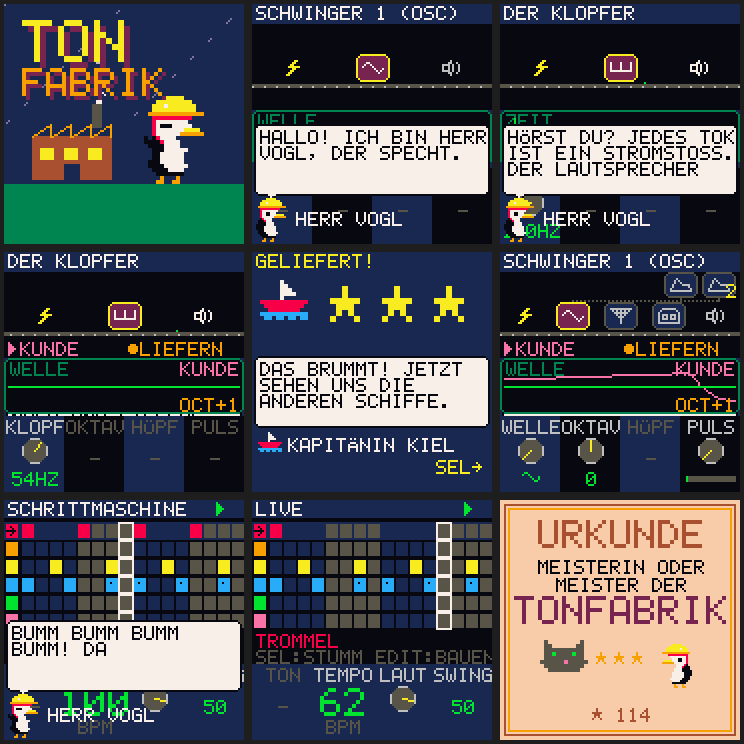

# Die Tonfabrik

Ein Lernspiel über Synthesizer für Kinder ab 7, als Firmware für den **M-VAVE FM-1**.

Du erbst die Tonfabrik von Onkel Alex. Hier werden Töne aus Strom gebaut, für alle, die einen brauchen. Der Vorarbeiter
**Herr Vogl**, ein Specht mit gelbem Helm, zeigt dir Maschine für Maschine: erst den Klopfer, aus dem bei 20 Stößen pro
Sekunde ein Ton wird, dann Schwinger, Tor, Hüllkurve, Filter, Wackler, Echo, Schrittmaschine und FM. Danach rufen
Kundinnen und Kunden an: Die Blaskapelle braucht vor dem Stadtfest eine neue Trommel, die Kuh Lotte hat ihre Stimme
verloren, das Museum sucht den Ton seiner alten Orgel, Pixel-Pia will einen Sprung-Sound. Du hörst dir an, was sie
wollen, baust es nach und lieferst aus.

**Im Browser spielen:** `docs/index.html` öffnen (derselbe C-Kern wie im Gerät, als WebAssembly). Nach dem ersten Push auf
`main` auch unter https://g0rst.github.io/Fm1-Hero/ ; Pages muss dafür einmal auf „GitHub Actions“ stehen
(Settings › Pages › Source).

**Entwicklermodus (nur im Browser):** Der dritte Platz (Frosch) heißt dort „ENTWICKLER“: alle Kapitel, Aufträge,
Minispiele und LIVE sind offen, auf der Karte kann man frei springen, und **ARP** (Tastatur: A) überspringt, was gerade
dran ist: Sprechblase, Aufgabe, Auftrag (mit 3 Sternen) oder Minispiel. Katze und Hund spielen normal; in der Firmware
gibt es den Modus nicht.
Unter dem Gerät erscheinen dann ein großer Knopf **Überspringen** (wie ARP) und **„Meldung an die Entwicklung“**:
Art wählen, aufschreiben, **Senden**. Die Meldung wird sofort als Issue in diesem Repository angelegt, mit der Stelle
im Spiel (Platz, Bildschirm, Kapitel und Schritt mit dem Text von Herrn Vogl, Auftrag mit Sternen, Maschine,
Reglerwerte, Patch und Ziel; erfasst, wenn man anfängt zu schreiben) und einem Bildschirmfoto (im Zweig
`feedback-bilder`). Dafür braucht die Seite einmal einen GitHub-Schlüssel (fine-grained token nur für Fm1-Hero:
Issues und Contents lesen und schreiben); er bleibt im Browser. Ohne Netz warten Meldungen und gehen beim nächsten
Senden mit.

**Handbuch für Eltern und Lehrkräfte:** [`docs/handbuch.html`](docs/handbuch.html)

## Was das Spiel kann

- **Geschichte**: 11 Kapitel, jedes führt eine Maschine ein. Herr Vogl erklärt in kurzen Sätzen, das Kind probiert
  aus, was er sagt (das Spiel wartet, bis der Regler wirklich gedreht ist), dann kommen Aufträge. Dazwischen
  „Wusstest du's?“-Karten zu Physik und Elektrotechnik (Hertz, Obertöne, Schallgeschwindigkeit, Schwebung, Echo der
  Fledermäuse) und ein wenig Musiktheorie (Oktave, Takt, BPM, Dur und Moll).
- **35 Aufträge (33 Klänge, 2 Takte) und 3 Minispiele** (Hoch oder tief?, Welche Welle?, Spiel mir nach!). Bewertet wird mit 1 bis 3 Sternen.
  Verglichen werden nur die Regler, die das Kind schon kennt; der Rest kommt fertig auf den Werktisch. Liegt es daneben,
  sagt Herr Vogl, was nicht passt („Zu hell! Dreh den Filter zu.“), und ob es nur ein bisschen oder weit daneben ist.
  Die Bewertung ist streng: 3 Sterne bis 5 Schritte daneben, bestanden nur bis 16 (Klopfer-Frequenz: bis 6 Schritte,
  also etwa ±25 %). Alle Regler zeigen ihren genauen Wert, eine Raste ist ein Schritt. In der Geschichte und auf
  „leicht“ zeigen drei Sterne oben rechts laufend, wie nah der Klang schon ist. Die Aufgaben von Herrn Vogl nennen
  genaue Ziele („K1: Stell 1 Hz ein!“, „K2 Fall auf 90!“) statt „dreh mal auf“.
- **Auftrags-Modus**: endlos neue Anrufe, jedes Mal etwas anders, in drei Stufen: **leicht** mit Oszi und Tipps,
  **mittel** nur mit Oszi, **schwer** nur mit den Ohren.
- **Live-Modus**: 16-Step-Sequencer mit vier festen Spuren (Trommel, Klatsch, Zisch, Bass) und zwei freien, deren
  Klang aus dem Tonlager kommt: Grundklänge und jeder Klang, den das Kind im Spiel gebaut hat. Jede Spur lässt sich in
  ihrer eigenen Fabrik umbauen; REC nimmt live auf.
- **Drei Spielstände** (Katze, Hund, Frosch), z. B. für Geschwister.
- **Lichter als Lehrer**: Was das Kind drücken soll, blinkt. Die weißen Tasten zeigen die Schritte, die schwarzen die
  Spuren. Beim Klopfer blinken alle Tasten mit jedem Stromstoß; beim Auftrag blinkt die Taste der Kundin. PLAY
  leuchtet grün für richtig, rot für falsch. Die Sterne laufen als Lauflicht über die Tasten. Genutzt werden alle
  Stufen der FM-1-LEDs: aus, glimmend, mittel, hell.
- **Bild**: 120 × 120 Pixel in 16 Farben, doppelt so groß aufs Display. Das spart Speicher (14 KB statt 112 KB) und gibt
  den Pixel-Look. Die Werkstatt ist ein Bild: oben die Maschinen als Leiste in der Reihenfolge des Klangs (Strom bis
  Lautsprecher, dann die Steuer-Maschinen), darunter groß das Oszilloskop mit der Welle (WELLE, mit der Frequenz in
  Hz) oder der Lautstärke über die Zeit (ZEIT), dazu blassrosa die Welle der Kundschaft; unten die vier Regler.
  Das Oszi zeigt immer etwas: Ohne Taste eine **Vorschau** des eigenen Klangs (neu berechnet, sobald ein Regler kurz
  stillsteht), mit Taste das echte Signal. Die Welle zeigt immer zwei ganze Schwingungen, auf volle Höhe skaliert.
  Das Zeitbild läuft mit, solange der Ton klingt, auch nach dem Loslassen: Man sieht das Tor aufgehen und wieder
  zugehen; ein weißer Strich zeigt „jetzt“. Die Maschine wählt das passende Bild selbst (Tor, Hüllkurven, Echo:
  ZEIT; Wackler: ZEIT mit 2 Sekunden, bei Ziel „Ton“ WELLE; sonst WELLE), SEL schaltet um. Das Tor in der Leiste
  füllt sich mit der Lautstärke.
  Das Oszi zeichnet seine Kurven in voller Displayauflösung (240 Punkte), feiner als der Pixel-Look drumherum.
  **PRESETS** (oder ALGORITHM) zoomt in der Werkstatt: das Zeitbild von 0,15 bis 4,8 Sekunden (zum Feineinstellen
  von START und FALL), die Welle von 1 bis 8 Schwingungen.

| Kapitel | Maschine | Lernziel |
| --- | --- | --- |
| 1 Der Klopfer | Klopfer (Impulse) | Strom, Frequenz, Hertz, ab 20 Hz ein Ton, Tasten, Oktave |
| 2 Die Wellen | Schwinger (OSC) | Sinus, Dreieck, Säge, Rechteck, Pulsbreite, Rauschen, Obertöne |
| 3 Das Tor | VCA | Gate, Lautstärke, Verzerrung |
| 4 Die Hüllkurve | ENV | Start, Fall, Halten, Ende (ADSR) |
| 5 Der Filter | VCF, ENV 2 | Helligkeit, Resonanz, Filter-Hüllkurve, Tief-/Band-/Hochpass |
| 6 Der Wackler | LFO | Vibrato, Tremolo, Wah, Formen |
| 7 Zwei Schwinger | OSC 2, Tonsprung | Schwebung, Mischen, Trommeln aus Sinus und Rauschen |
| 8 Echo und Hall | FX | Schallgeschwindigkeit, Echo, Hall |
| 9 Der Takt | Sequencer | 16 Schritte, 4/4-Takt, Tempo, Dur und Moll |
| 10 FM-Zauber | FM | Frequenzmodulation, Verhältnisse, Glocken und E-Piano |
| 11 Meisterprüfung | alle | Löwe, Münze, Meer, Rakete; danach Urkunde |

## Bedienung

| | |
| --- | --- |
| **SEL** | weiter (Sprechblasen), auswählen; in der Werkstatt: Bild WELLE / ZEIT |
| **HOME** | zurück (in der Werkstatt zweimal) |
| **SELECT** (großer Drehregler) | Maschine am Fließband wählen, in Menüs blättern |
| **KNOB1–4** | die vier Regler der gewählten Maschine |
| **ENV / LFO / FX / EDIT** | direkt zu Hüllkurve (zweimal: Hüllkurve 2), Wackler, Echo + Hall; EDIT: nächste Maschine |
| **Tasten, OCT− / OCT+** | den eigenen Ton spielen, Oktave |
| **PLAY** | beim Auftrag: den Ton der Kundschaft hören; Sequencer: Start / Stopp |
| **REC** | beim Auftrag: ausliefern; im Live-Modus: aufnehmen |
| **GLO** | Tipp von Herrn Vogl (Geschichte und Auftrags-Modus „leicht“) |
| **SEQ** | Schrittmaschine; im Live-Modus: zwischen Schritten und Fabrik der Spur |
| **SAVE** | im Live-Modus speichern; auf der Platzwahl 3 s halten: Spielstand löschen |
| **PRESETS** | in der Werkstatt: Zoom des Oszis; im Live-Modus (Schritte): Klang der freien Spuren aus dem Tonlager |

Fortschritt wird nach jedem Auftrag und jedem Kapitel von selbst gespeichert.

## Stand

| Teil | Zustand |
| --- | --- |
| Kern (`app/core/`): Klang, Spiel, Bild, Inhalte | läuft; Host-Tests grün (`tests/run_tests.sh`) |
| Alle 11 Kapitel durchspielbar | ein Test-Roboter spielt sie bei jedem Lauf ganz durch, dazu den Auftrags-Modus (`tests/test_story.c`) |
| Inhalte | geprüft: Texte passen auf den Bildschirm, jeder Auftrag ist lösbar und nicht schon gelöst |
| FM-1-Anbindung (`app/app.c`) im Host-Simulator von fm1-base | läuft (`app/tests/basic.txt`) |
| Browser-Version (`docs/index.html`) | läuft |
| Firmware-Paket `.fwsc` | wird bei jedem Push von GitHub Actions gebaut (Artefakt `firmware`); besteht die Prüfungen von fm1-base |
| Lauf auf einem echten FM-1 | **noch nicht getestet** |

Die Anbindung ist dieselbe wie bei ro:MINImal (fm1-base auf demselben Stand), das auf einem FM-1 läuft. Offen bis
zum ersten Lauf: die echte CPU-Last (`plat_cpu_pct`), wie das Pixelbild und die LED-Stufen am Gerät wirken, und der
Klang über Lautsprecher und Kopfhörer.

**Vor dem Flashen lesen:** Custom-Firmware kann einen FM-1 unbrauchbar machen. Der Chip hat nur eine Firmware-Bank und
keinen Recovery-Taster; neuere Hardware-Revisionen (M-VAVE-Logo unter dem Display) vertragen manche Custom-Firmwares
nicht. Vorher auf die offizielle V15 gehen, Daten sichern und wissen, wie man zurückkommt (Installer von fm1-base,
`base/README.md`). Installieren: `python3 base/tools/fm1_install.py app/build/tonfabrik.fwsc`.

## Speicher und Last

| | belegt | verfügbar |
| --- | --- | --- |
| Spielstände im Flash | 3 × 352 B bei `0xB1000`, `0xB3000`, `0xB5000` (je ein Sektorpaar) | Fenster `0xB1000–0xBAFFF` |
| Panel-Kalibrierung (Plattform) | `0xDC000` | Datenbereich von fm1-base |
| Firmware-Image (Flash) | 144 284 B | 581 564 B (App-Slot) |
| RAM .data + .bss (darin das Bild, 14 KB) | 40 188 B | 98 304 B |
| RAM-Pool (Echo 64 KB, Hall 13 KB, fm1-base) | 147 732 B | 344 064 B |
| RAM-Code (.ram_text) | 5 100 B | 32 768 B |
| Klang, schlimmster Fall (9 Stimmen mit FM, Filter, Wackler, Kratz, Echo, Hall) | ca. 2 160 Instruktionen pro Sample (callgrind, x86-64) | Budget 8 163 Takte pro Sample |

Die Spielstände liegen im selben Fenster wie bei ro:MINImal und berühren keinen geschützten Bereich: nicht Kopf und
Bootloader (`0x00000–0x03FFF`), nicht die Bluetooth-Kopplung (`0xC0000–0xC1FFF`), nicht das Staging des Updates
(ab `0xE0000`), nicht Werksressourcen und Kalibrierung (`0xF4000–0xFDFFF`), nicht Schlüssel und MAC
(`0xFF000–0xFFFFF`). `app/app.c` prüft das beim Übersetzen; ein Objekt außerhalb bricht den Build ab.

Der Klang ist in Wirklichkeit meist viel leichter: In der Werkstatt klingen ein bis zwei Stimmen, im Live-Modus
selten alle sechs zugleich. Was ein Auftrag am Anfang rechnet (sein Oszi- und Zeitbild, 1,2 s Klang ohne
Lautsprecher), läuft einmal in der Hauptschleife, nicht im Audio.

## Aufbau

    app/core/fab.h, fab.c     Schnittstelle; fab.c bindet die vier Teile ein (portables C99 ohne libc)
    app/core/synth.inc        Klang: Stimme als Produktionsstraße, 6 Spuren, Sequencer, Echo, Hall, Oszi
    app/core/gfx.inc          Bild: 16 Farben, Schrift mit Ä Ö Ü ß, Herr Vogl, 35 Kundenbilder, Maschinensymbole
    app/core/story.inc        Inhalte: Kapitel, Aufträge, Minispiele, Tonlager (nur Daten)
    app/core/game.inc         Spiel: Bildschirme, Story, Vergleich und Tipps, Minispiele, Live, Lichter
    app/app.c, app.h          Anbindung an fm1-base (Audio, MIDI, Panel, Display, LEDs, Speicher, Flash-Karte)
    app/fm1.toml              Build-Einstellungen für fm1-base
    base/                     fm1-base als Submodul (darin felucca-bsp): Plattform, Build, Installer
    sim/                      Browser-Version: wasm.c, page.html, build.sh  ->  docs/index.html
    tests/                    Host-Tests: test_core.c (Kapitel 1, Takt, Live), test_story.c (Inhalt, alle Kapitel), test_cpu.c
    prototype/index.html      der frühere Guitar-Hero-Prototyp (Regler-Rhythmus), als Idee für ein weiteres Minispiel

Neue Aufträge sind eine Zeile in `story.inc`: wer anruft, was gebraucht wird und die Regler, die anders sind als am
Anfang. `tests/test_story.c` prüft, dass der Auftrag lösbar ist und seine Texte passen.

## Bauen und testen

    git clone --recursive https://github.com/g0rst/Fm1-Hero
    tests/run_tests.sh        # Host-Tests (cc); Bildschirmfotos nach build/tests und build/story, dazu live.wav
    sim/build.sh              # Browser-Version (clang mit wasm32-Ziel, wasm-ld, python3)
    ./build.sh --host         # Host-Simulator von fm1-base (python3, Pillow, cc)
    ./build.sh                # Firmware-Paket app/build/tonfabrik.fwsc (JieLi-Toolchain, AC79-SDK)

Ohne eigene Toolchain: Das Paket hängt als Artefakt `firmware` an jedem Lauf des Workflows `build` unter Actions.

## Lizenz

GPL-3.0-only für die Dateien dieses Repositorys (`LICENSE`). `base/` (fm1-base, felucca-bsp) steht unter MPL-2.0; ein
Firmware-Paket enthält außerdem drei Dateien aus JieLis AC79-SDK (Apache-2.0). Die Schrift (5 × 7) stammt aus
ro:MINImal. Nicht mit M-VAVE oder JieLi verbunden.
